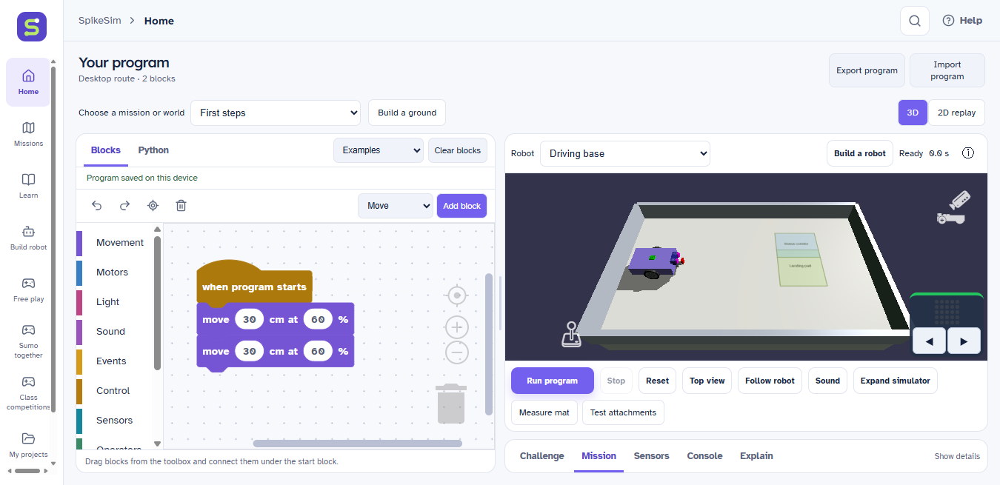
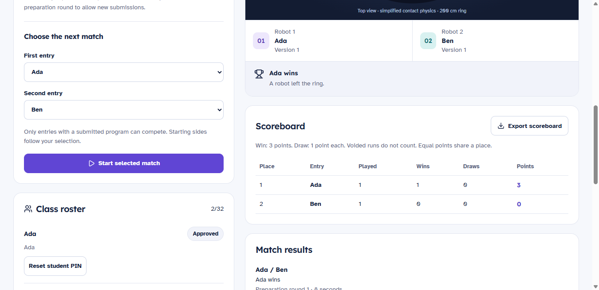

# SpikeSim

**A little code. A world of possibilities.**

Build a virtual robot, connect a few blocks, and watch your ideas move. SpikeSim
brings coding, 3D practice and guided lessons into one offline robotics workspace.

*The real SpikeSim workspace: editable blocks, a virtual robot and a 3D practice field.*

The download website is configured for **Vercel connected to GitHub**. GitHub
stores the source and Windows release files; Vercel serves `website/` using the
root `vercel.json`. Run `npm.cmd run site:dev` for the local website and
`npm.cmd run site:check` for its browser checks. See [release setup](docs/releasing.md).
The website keeps downloads disabled until a real release asset is published.

The original SpikeSim identity now includes a route-S mark, consistent app/session
branding, desktop icons and reusable SVG/PNG artwork. Review the local
[brand studio](public/brand/index.html) or [brand guide](docs/branding.md).
With the preview running, open http://127.0.0.1:5173/brand/index.html.

**Learn** now offers 17 lessons for secondary-school students, with familiar examples,
existing demonstration videos, 51 explained screenshots, predictions and short checks.
Students can edit and run a separate lesson experiment without replacing their projects.
Topics include Python reading, My Blocks and their inputs, custom gyro turns, yaw and
wheel conversions. The interactive angle and wheel tools explain the maths visually.
Python remains a read-only view of simulator helper code. See [Learn](docs/learning.md).
The lesson library also filters completed lessons and lessons still to finish,
with searchable results and completion counts.

**Sumo together** lets two students compete using blocks on the same Wi-Fi. Build the
app and run `npm.cmd run sumo:host` for browser hosting, or host from the desktop app.
Share the local invitation link/code. See [hosting and limitations](docs/sumo-lan.md).
The redesigned sumo screen has player readiness cards, a round clock, a clearer
host/join setup and an arena-only expanded view with keyboard controls.
The host also serves Learn videos, captions and runnable 3D experiments.
**Class competitions** supports individual or team entries in sumo and timed 3D
arenas. Teachers can choose starter courses, FLL practice tasks, maze, fire rescue
and bundled FLL/WRO fields, with preparation and run timers. Completed attempts
rank by fastest time. Full competition fields use a published task and teacher
confirmation; timers and rankings remain automatic. Approval, editing handover,
locked submissions, saved results and CSV/program export are included.
After building, run `npm.cmd run classroom:host`
and open http://127.0.0.1:41866/?competition=host. See the
[teacher guide and remaining scope](docs/teacher-competitions.md).

*Class competitions with demonstration students: prepare, run a match and review the results.*

The app opens one student workspace: 66 simple Blockly instructions beside a large Gears-powered 3D simulator. One picker includes 41 learning missions, 32 Gears practice challenges, 38 FLL/WRO fields, and open practice. The simulator has ten robot choices, live sensors, hub lights, sound, camera controls, a resizable split, and an expanded view. There is no separate Gears library screen. Projects retain their blocks, robot ports, selected robot, and world.

Build a robot opens the physical component editor inside SpikeSim. Its FLL practice base has drive motors, front and rear powered attachments, color/distance sensing, and a gyro. Add or position parts, change dimensions, and use the result with your existing blocks. Build a ground edits field images, objects, walls, and mechanisms; it also accepts your own PNG/JPEG/WebP image. Custom designs save inside `.rlproj` files and remain available when switching back to a preset. The simulator stays covered by SpikeSim's loading screen until the selected world is ready, so the upstream editor no longer flashes during loading.

The FLL collection has eight mats (2018–2025), with two RePLAY 2020 layouts. The copied 2018, 2019 and 2025 fields have no mission models and are labelled **Mat only**; the 2020–2024 fields include models. These are practice fields, not a claim that every official FLL mission has an implemented score checker.

Run the browser version with `npm.cmd run dev:web` and open http://127.0.0.1:5173. Drag a Movement block beneath the start block, then click Run program. Examples includes a square, lights and sound, and a distance-sensor loop. F5 or Ctrl+Enter runs in 3D; Escape stops; Ctrl+R resets. The 2D replay also supports pause, stepping, playback speed, and a timeline.

Import program accepts SpikeSim `.rlproj` and supported SPIKE Prime `.llsp3` / Scratch `.sb3` word-block projects. Nested archives, block graphs, and ports are validated before replacing a draft. Unsupported Python projects, icon blocks, events, or instructions are reported without changing the open program. This is a conversion, not full SPIKE compatibility: the virtual hub does not run SPIKE firmware, and real routes need calibration.

Our block-generated Python controls Babylon/Ammo physics through a bounded Skulpt adapter inside the embedded simulator. The main desktop renderer keeps its strict CSP; the legacy engine has a separate loopback origin with no Electron preload privileges. The optional deterministic SVG 2D replay uses the existing worker graph interpreter. The Python tab remains a read-only helper-code preview. The two simulators have different physics and timing; they are not synchronized camera views. Learning-mission scoring uses actual observations from the selected simulator. All 41 classroom reference programs have deterministic 2D tests and recorded three-star 3D runs, with projects and results in `recordings/index.html`. Remaining practice and competition coverage is unfinished, and new mission/video work is paused. Competition fields do not award classroom mission stars.

Gears source, robots, worlds, models, upstream examples, and notices are bundled in `public/gears/`. The simple toolbox does not yet expose every Gears-specific device (such as camera vision, GPS, or pen drawing), arbitrary Gears XML/Python projects, or multi-robot programming. The builder assembles simulation components rather than individual LEGO bricks. Direct Python editing, permanent XP/unlocks, cloud classroom sync and assignment packs remain unfinished. Local teacher competitions are described above. See [the workspace notes](docs/unified-workspace.md) for the runtime and port mapping.

`npm.cmd run build` builds the web app and Electron entry files. Windows installers are distributed through [GitHub Releases](https://github.com/Muyiez101/SpikeSim/releases). Local installation, installed-app acceptance and uninstall passed, including simulator/builders, program files, lesson media, classroom workers and restart recovery. `npm.cmd run desktop:check` repeats acceptance with isolated data. This is an unsigned Windows preview. See [Windows packaging and acceptance](docs/packaging.md) for instructions and remaining limits.

Validation: `npm.cmd run lint`, `npm.cmd run typecheck`, `npm.cmd test -- --maxWorkers=1`, `npm.cmd run e2e -- --workers=1`, and `npm.cmd run build`. Blockly notices are bundled in `public/licenses/`. Gears is GPL-3.0; preserve its notices and provide corresponding source for GPL-covered distributions. Upstream FLL artwork redistribution permission remains unverified. The repository includes the full simulator with its upstream licenses and credits. See [asset notices](public/gears/SPIKESIM-NOTICE.md).

## Original design pack

Working title: **RoboLab Sim** (change it in one place: `src/shared/brand.ts`).

An offline desktop app where students learn robotics with a virtual SPIKE Prime-style robot. They build a robot, write programs with blocks or Python, and watch it run in a 2D or 3D simulator, with built-in explanations, missions, and rewards.

## How to use this pack with an AI coding agent

1. Create a new empty repo. Copy `CLAUDE.md` to the repo root and the `docs/` folder next to it.
2. Open your AI coding agent (for example Claude Code) in the repo.
3. Start with this prompt:

> Read CLAUDE.md and every file in docs/ in order. Summarise the plan back to me in 10 lines and list any questions. Then build Phase 0 from docs/09-BUILD-PLAN.md. Stop at the end of the phase and show me how to run it.

4. Build one phase at a time. Test each phase yourself before starting the next. Each phase in `docs/09-BUILD-PLAN.md` has a ready-to-paste prompt and acceptance criteria.

## File index

| File | What it tells the AI |
|---|---|
| `CLAUDE.md` | Rules the AI must follow on every task |
| `docs/01-PRD.md` | What the product is, who it is for, what is in and out of scope |
| `docs/02-ARCHITECTURE.md` | Tech stack, folder layout, modules, data flow, security |
| `docs/03-DESIGN-SYSTEM.md` | Look, feel, navigation, screens, components |
| `docs/04-BLOCKS-SPEC.md` | Every block, its category, and the Python it generates |
| `docs/05-SIMULATION-SPEC.md` | Physics, motors, sensors, 2D and 3D rendering |
| `docs/06-MISSIONS-SPEC.md` | Mission file format, map format, full mission list |
| `docs/07-LEARNING-SPEC.md` | Teaching design: explain panel, hints, quizzes, rewards, teacher tools |
| `docs/08-ROBOT-BUILDER-SPEC.md` | Robot builder, parts, presets, build guides |
| `docs/09-BUILD-PLAN.md` | Phases, prompts, acceptance criteria |
| `docs/10-QUALITY-CHECKLIST.md` | Testing, performance, accessibility, packaging |

## Non-negotiables

- Fully offline after install. No network calls at runtime.
- Easy enough that a first-time student can run their first program in under two minutes.
- No LEGO logos, artwork, or fonts. The look is SPIKE-style, never a copy.
- Blocks and Python always stay in sync and always run through the same engine.
